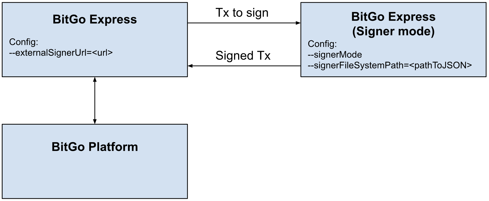

# BitGo Express External Signing Mode

BitGo Express can be run in an external signing mode, where the signing of transactions is performed in a separate instance of BitGo Express that has access to the private keys.
This may be preferable for users who would like to apply their signature to their transactions using a more secure environment than BitGo SDK or BitGo Express, such as a signer with restricted access or network connectivity.



### External signer mode setup

To set up BitGo Express with an external signer, a url to the external signer instance of BitGo Express must be provided using the `externalSignerUrl` configuration option.
The corresponding external signer instance of BitGo Express must have `signerMode` set, and `signerFileSystemPath` set to the path of a json containing the private key.
Both instances must be configured with the same shared secret via `signerAuthSecret`; see [Signer authentication](#signer-authentication) below.
A signer-mode instance must either listen on loopback (the default `localhost` bind, or `--ipc`) or serve TLS with client authentication; see [Signer authentication](#signer-authentication).
Note that if BitGo Express encounters an `ECONNREFUSED` error when requesting the external signer for a signature, it will retry the request for up to 15 seconds.

### Signer authentication

Signer-mode routes have access to the wallet keys, so every request to them must be authenticated. Both the online instance (configured with `externalSignerUrl`) and the signer instance (configured with `signerMode`) must be configured with the same shared secret of at least 16 printable non-whitespace ASCII characters:

- CLI: `--signerauthsecret=<secret>`
- Environment variable: `BITGO_SIGNER_AUTH_SECRET`

The online instance sends the secret in the `X-Auth-Signer` header on every request to the signer. The signer compares it in constant time and rejects requests without a matching header with a `401` before any wallet key material or passphrase is accessed.

A signer-mode instance listening on anything other than loopback (or an IPC socket) must additionally be configured with TLS client authentication, so the shared secret cannot be intercepted on the network:

- `--sslca=<path to CA certificate>` together with `--keypath`/`--crtpath` (or `--sslkey`/`--sslcert`)

The online instance must present a client certificate to such a signer. Configure it on the instance using `--externalSignerUrl`:

- `--signerclientkey=<path>` and `--signerclientcert=<path>` (or `BITGO_SIGNER_CLIENT_KEY` / `BITGO_SIGNER_CLIENT_CERT`), provided together
- optionally `--signerclientca=<path>` (or `BITGO_SIGNER_CLIENT_CA`) when the signer's server certificate is issued by a private CA

The client certificate, key and CA are attached to every outbound request to the signer. Startup fails if `--signerclientkey` or `--signerclientcert` is set without the other, or if any of the configured files is unreadable.

Startup fails if `signerMode` is set without a secret, if `externalSignerUrl` is set without a secret, or if a signer listens on external interfaces without TLS client authentication.

### Encrypted private key format

The JSON file containing the unencrypted private key(s) must be in the format `"<walletId>": "<encryptedPrivateKey>"`. Note that the `encryptedPrivateKey` must contain escape characters for the double quotations(`"`) in order for it to be parsed correctly.
Here is an example json file containing two wallet IDs and their corresponding encrypted private keys with escape characters:

```
{
"<walletId1>":"<encryptedPrivateKey1>",
"<walletId2>":"<encryptedPrivateKey2>"
}
```

To help with the creation of this JSON file, we have created a file that will fetch the encrypted private keys from BitGo and produce a JSON file with the correct format (including the addition of escape characters).

The file is located at `src/fetchEncryptedPrivKeys.ts`. Before using this tool, you will need to either:

1. Fill in the `TODOs` by providing a valid `accessToken` as well as the list of `walletIds`, grouped by the cryptocurrency.
2. Using the same information as #1, update the .env file with the `accessToken` and `walletIds` information.

| Name                                      | Value  | Description                                 |
| ----------------------------------------- | ------ | ------------------------------------------- |
| BITGO_EXTERNAL_SIGNER_ENV                 | string | test                                        |
| BITGO_EXTERNAL_SIGNER_ACCESS_TOKEN        | string | Access token used for access BitGo Wallets  |
| BITGO_EXTERNAL_SIGNER_WALLET_IDS          | string | JSON formatted string of wallets and their  |
|                                           |        | ids, the secret is optional for unencrypted |
|                                           |        | private material                            |
| BITGO_EXTERNAL_SIGNER_WALLET_IDS_WITH_PRV | string | JSON formatted string of wallets ids and    |
|                                           |        | their encrypted private keys                |

BITGO_EXTERNAL_SIGNER_WALLET_IDS examples:

```
BITGO_EXTERNAL_SIGNER_WALLET_IDS="{"tbtc":[{"walletId":"xxx","walletPassword":"xxx","secret":"xxx"}],"hteth":["walletId":"xxx","walletPassword":"xxx"]}"
```

BITGO_EXTERNAL_SIGNER_WALLET_IDS_WITH_PRV examples:

```
BITGO_EXTERNAL_SIGNER_WALLET_IDS_WITH_PRV="[{"walletId":"xxx","encryptedPrv":"xxx"}]"
```

Option #2 may make be more convenient for configuration instead of reconfiguring the file every time a new version is released both locally and to Docker.

An example is provided in the file. To run the file, use the command:

```sh
yarn tsx <path/to/fetchEncryptedPrivKeys.ts>
```

### Wallet passphrase
In order for the external signer instance of BitGo Express to decrypt the private key, the wallet passphrase is required.
Set it as an environment variable in the format `WALLET_<walletId>_PASSPHRASE`. Note that the wallet passphrase must be set for each wallet.
The environment variable can be set using `export`. For example, the wallet passphrases for the private keys above can be set with the following:

```
export WALLET_<walletId1>_PASSPHRASE=<YOUR_WALLET_PASSPHRASE>
export WALLET_<walletId2>_PASSPHRASE=<YOUR_WALLET_PASSPHRASE>
```

Signer-mode instances never accept a wallet passphrase in the request body; `walletPassphrase` body parameters are only honored by non-signer instances for local signing. Wrong passphrases and unknown wallet IDs are indistinguishable in error responses, and repeated failures lock a wallet ID temporarily.

### External signer mode configuration values

BitGo Express is able to take configuration options from either command line arguments, or via environment variables.

| Flag Short Name | Flag Long Name         | Environment Variable             | Default Value | Description                                                                                                                   |
| --------------- | ---------------------- | -------------------------------- | ------------- | ----------------------------------------------------------------------------------------------------------------------------- |
| N/A             | --externalSignerUrl    | `BITGO_EXTERNAL_SIGNER_URL`      | N/A           | URL specifying the external API to call for remote signing.                                                                   |
| N/A             | --signerMode           | `BITGO_SIGNER_MODE `             | N/A           | If set, run Express as a remote signer.                                                                                       |
| N/A             | --signerFileSystemPath | `BITGO_SIGNER_FILE_SYSTEM_PATH ` | N/A           | Local path specifying where an Express signer machine keeps the encrypted user private keys. Required when signerMode is set. |
| N/A             | --signerauthsecret     | `BITGO_SIGNER_AUTH_SECRET`               | N/A           | Shared secret used to authenticate requests to a signer-mode instance. Required when `signerMode` or `externalSignerUrl` is set. |
| N/A             | --sslca                | `BITGO_SSL_CA`                           | N/A           | Path to a CA certificate for TLS client authentication. Required when `signerMode` listens on external interfaces. |
| N/A             | --signerclientkey      | `BITGO_SIGNER_CLIENT_KEY`                | N/A           | Path to the PEM key presented to a signer-mode instance for TLS client authentication. Use together with --signerclientcert. |
| N/A             | --signerclientcert     | `BITGO_SIGNER_CLIENT_CERT`               | N/A           | Path to the PEM certificate presented to a signer-mode instance for TLS client authentication. Use together with --signerclientkey. |
| N/A             | --signerclientca       | `BITGO_SIGNER_CLIENT_CA`                 | N/A           | Path to the CA certificate that a signer-mode instance's server certificate is verified against. |

#### Example

To start up an instance of BitGo Express that will use an external signer, start BitGo Express with `--externalSignerUrl=<externalSignerUrl> --signerauthsecret=<secret>` (plus `--signerclientkey`/`--signerclientcert` and, if needed, `--signerclientca` when the signer requires TLS client authentication).
To start up an external signing instance of BitGo Express, which will have access to the encrypted private keys and wallet passphrases, start BitGo Express with `--signerMode --signerFileSystemPath=<encryptedPrivateKeysJson> --signerauthsecret=<secret>` (and, when listening on external interfaces, TLS client authentication via `--sslca` together with the server certificate options).
